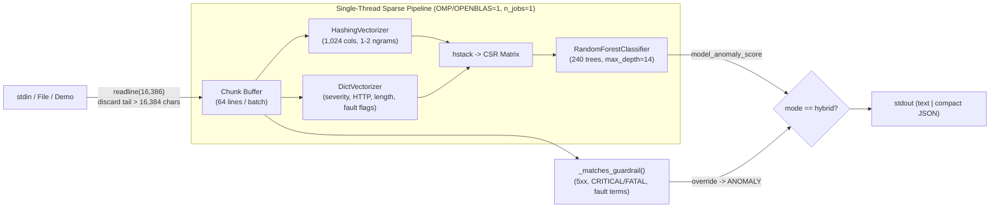

# Log Anomaly Detector

A streaming log anomaly classifier built to run inside a strict 240 MiB memory and swap limit (`--memory=240m --memory-swap=240m`) on a read-only container filesystem (`read_only: true`, `cap_drop: ALL`).

Standard `scikit-learn` pipelines often trip small container memory caps because of growing token vocabularies, multi-core BLAS/OpenMP thread arenas, `n_jobs=-1` forks, and unbounded line reads. This repository avoids those allocations so a 240-tree Random Forest plus deterministic operational rules fits comfortably inside a 240 MiB container.

## Measured Memory & Throughput

Verified in CI (`.github/workflows/ci.yml`) on Linux (`Python 3.11.18`, `numpy 2.3.5`, `scipy 1.17.0`, `scikit-learn 1.8.0`, `Docker 29.4.2`):

| Check | Command | Observed Result |
|---|---|---|
| Single-record throughput | `python benchmarks/benchmark.py --records 5000 --batch-size 64` | `63.25` records/sec |
| Batched throughput (`batch_size=64`) | `python benchmarks/benchmark.py --records 5000 --batch-size 64` | `3499.19` records/sec (`140.14 MiB` peak RSS) |
| 240 MiB container probe (`cgroup_v2`) | `python scripts/validate_docker.py` | `82.25 MiB` cgroup peak, `125.79 MiB` process RSS, `oom_killed: false`, `PASS` |

Container validation output (`scripts/validate_docker.py`):

```json
{
  "image": "log-anomaly-detection-system:validation",
  "docker_server_version": "29.4.2",
  "memory_limit_bytes": 251658240,
  "memory_limit_mib": 240.0,
  "demo_exit_code": 0,
  "probe_exit_code": 0,
  "oom_killed": false,
  "docker_stats_sample_count": 4,
  "docker_stats_peak_bytes": 86245376,
  "docker_stats_peak_mib": 82.25,
  "cgroup_peak_bytes": 86245376,
  "cgroup_peak_mib": 82.25,
  "process_peak_rss_mib": 125.79,
  "observed_peak_bytes": 86245376,
  "observed_peak_mib": 82.25,
  "result": "PASS"
}
```

## Quickstart & CLI Options

Install the pinned dependencies (`numpy==2.3.5`, `scipy==1.17.0`, `scikit-learn==1.8.0`):

```bash
pip install -r requirements.txt
python app.py --demo
python app.py --demo --mode ml-only --format json
python app.py --input samples/sample.log --format json
cat samples/sample.log | python app.py --batch-size 64
python app.py --normal-training normal.log --anomaly-training anomaly.log --input app.log
```

Sample output with `--format json`:

```json
{"label":"ANOMALY","decision_value":-0.4875,"model_anomaly_score":0.9875,"message":"ERROR: HTTP 500 Internal Server Error","source":"operational_guardrail"}
```

Run inside the hardened Compose container (`cap_drop: ALL`, `read_only: true`, `16 MiB` `/tmp` `tmpfs`, UID/GID `10001`):

```bash
docker compose up --build
python scripts/validate_docker.py
```

| Flag | Default | Notes |
|---|---|---|
| `--demo` | off | Stream the 6-line built-in fixture (mutually exclusive with `--input`) |
| `--input PATH` | `stdin` | Stream bounded lines from `PATH` |
| `--normal-training PATH` | bundled | Custom normal corpus (must pair with `--anomaly-training`) |
| `--anomaly-training PATH` | bundled | Custom anomaly corpus (requires at least `8` normal and `8` anomaly lines) |
| `--mode` | `hybrid` | `hybrid` (RF + guardrails) or `ml-only` |
| `--format` | `text` | Human-readable lines or compact single-line `json` |
| `--batch-size` | `64` | Records vectorized per `predict_proba` call (`>= 1`) |
| `--max-train-records` | `50000` | Line cap per custom training file (`>= 8`) |

## How Memory & Scoring Work



- **Bounded line ingestion:** `_iter_bounded_lines()` reads up to `16,384` characters (`MAX_LINE_CHARS`) per record with `readline(MAX_LINE_CHARS + 2)` and drains oversized line tails in chunks so one giant log record cannot cause an OOM kill. Custom training files are capped by `--max-train-records` (`50,000`).
- **Fixed-width sparse features:** Feature extraction combines a stateless `HashingVectorizer(n_features=1024, ngram_range=(1, 2), norm="l2", alternate_sign=False)` with a sparse `DictVectorizer` over `metadata_features()` (line-length bucket, severity, HTTP `>= 400`, and fault keywords). Joining them into one CSR matrix keeps feature dimensionality fixed:

```text
[  1,024 hashed unigram/bigram L2 weights  |  sparse structural metadata flags  ]
|<-------------- fixed width ------------->|<-------- bounded feature set ------->|
```

- **Single-thread BLAS and training on boot:** `Dockerfile` and `benchmarks/benchmark.py` pin `OMP_NUM_THREADS`, `OPENBLAS_NUM_THREADS`, `MKL_NUM_THREADS`, and `NUMEXPR_NUM_THREADS` to `1`, with `n_jobs=1` on the forest. `LogAnomalyDetector.fit()` trains in memory on startup rather than loading `pickle`/`joblib` binaries, which keeps `/` read-only and avoids `scikit-learn` serialization mismatches.
- **Hybrid scoring:** `detect_batch()` scores all `64` lines through `RandomForestClassifier.predict_proba()` first so `model_anomaly_score` stays populated on every record even when `_matches_guardrail()` overrides `5xx`, `CRITICAL`/`FATAL`, `kernel panic`, or resource-pressure `WARN` lines in `hybrid` mode. Passing `--mode ml-only` uses `anomaly_prob >= 0.5` alone.

## Template-Disjoint Evaluation

`evaluation/evaluate_model.py` (`evaluation/results.json`, `seed=20261103`) separates templates between splits so training phrasing does not leak into test metrics. Training uses `320` normal and `320` anomaly lines across `12 + 13` templates; validation uses `120` normal lines; testing covers `340` lines across `4` unseen normal templates, `5` unseen anomaly templates, and `20` prefix-free cases:

| Configuration | Precision | Recall | F1 | FPR | Accuracy |
|---|---|---|---|---|---|
| Random Forest (`ml-only`) | `0.9843` | `0.7353` | `0.8418` | `0.0118` | `0.8618` |
| Hybrid (`RF + guardrails`) | `0.9877` | `0.9471` | `0.9670` | `0.0118` | `0.9676` |

Out of the `340` held-out predictions in hybrid mode, `124` were caught by `operational_guardrail` and `216` by `random_forest_classifier`.

## Repository Layout, Tests & Scope

```text
app.py                          # Bounded ingestion, feature fusion, RF + guardrails, CLI
training_data.py                # Baseline training corpus and template generator
evaluation/                     # Template-disjoint evaluation runner and results.json
benchmarks/benchmark.py         # Single vs. batch throughput and peak RSS probe
scripts/                        # 240 MiB Docker + cgroup memory validation suite
samples/sample.log              # Sample input fixture for local CLI tests
tests/                          # test_app.py, test_evaluation.py, test_docker_validation.py
```

```bash
python -m unittest -v
python -m evaluation.evaluate_model --output evaluation/results.json
```

`.github/workflows/ci.yml` runs `unittest` with `coverage`, tests `--demo` in both modes, regenerates `evaluation/results.json`, runs `benchmarks/benchmark.py` across Python `3.11` and `3.13`, and executes `scripts/validate_docker.py` in a separate `docker-memory-validation` job.

Note that bundled logs are synthetic templates unless `--normal-training` and `--anomaly-training` are provided, probabilities threshold directly at `0.5` without calibration, classification is stateless per line (multi-line stack traces and cross-request bursts are out of scope), and fitting the 240-tree forest adds a brief startup cost on cold boot.
