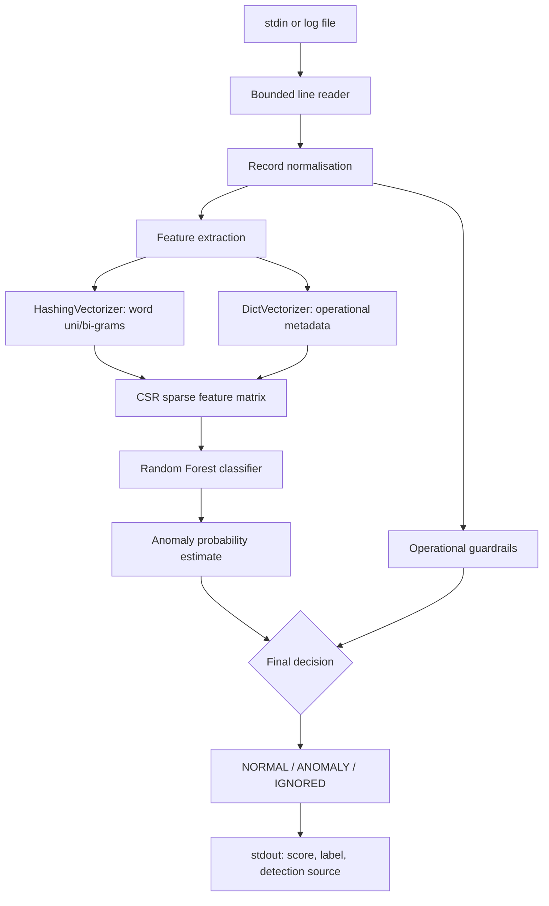

# Log Anomaly Detection System

[](https://github.com/Bisher-eng-1/log-anomaly-detection-system-engineering/actions/workflows/ci.yml)


A resource-constrained, streaming log-analysis prototype built with Python and scikit-learn. It combines a supervised Random Forest classifier with explicit operational guardrails, sparse text/metadata features, bounded input processing, Docker memory controls, and reproducible evaluation tooling.

---

## Table of Contents

1. [Engineering Goals](#engineering-goals)
2. [Architecture & Processing Stages](#architecture--processing-stages)
3. [Machine-Learning Design](#machine-learning-design)
4. [Operational Guardrails](#operational-guardrails)
5. [Held-Out Synthetic Evaluation Summary](#held-out-synthetic-evaluation-summary)
6. [Repository Structure](#repository-structure)
7. [Quick Start & CLI Usage](#quick-start--cli-usage)
8. [Automated Tests & Benchmarks](#automated-tests--benchmarks)
9. [Docker Deployment & Memory Validation](#docker-deployment--memory-validation)
10. [Known Limitations & Next Steps](#known-limitations--next-steps)
11. [References](#references)

---

## Engineering Goals

- Process log records incrementally rather than loading an entire input log into memory.
- Classify each record using a trained machine-learning model and report the model's anomaly-probability estimate.
- Apply deterministic guardrails to selected high-confidence operational failures.
- Keep feature matrices sparse and per-record size strictly bounded.
- Run as a non-root Docker container with a configured memory ceiling below 256 MiB (`240 MiB`).
- Make tests, synthetic evaluation, throughput measurements, and container-memory validation repeatable.

---

## Architecture & Processing Stages



1. **Bounded input:** Standard input and file input are consumed one physical line at a time (`readline(MAX_LINE_CHARS + 2)`). Each record is capped at `16,384` characters; oversized remainders are discarded without buffering before reading the next line.
2. **Text features:** `HashingVectorizer` produces a fixed-width `1,024`-feature vector with `(1, 2)` word n-grams, avoiding unbounded in-memory vocabulary growth.
3. **Operational metadata:** `DictVectorizer` encodes log severity (`DEBUG`, `INFO`, `WARN`, `ERROR`, `CRITICAL`/`FATAL`, `UNKNOWN`), length buckets, contextual HTTP error flags, and keyword indicators (exceptions, timeouts, CPU, memory/OOM, disk/storage, auth failures, restarts, network faults).
4. **Sparse representation:** Text and metadata matrices are combined into a SciPy CSR sparse matrix.
5. **Classifier:** A `RandomForestClassifier` is fitted once at startup on labelled normal and anomaly examples.
6. **Operational guardrails:** Explicit deterministic rules override the ML classifier for high-confidence failures (HTTP `5xx`, resource-pressure warnings, `CRITICAL`/`FATAL` prefixes, and fatal error signatures).
7. **Output:** Each non-empty record emits a label, signed classifier margin (`0.5 - model_anomaly_score`), class-1 probability estimate, and decision source.

---

## Machine-Learning Design

### Feature Representation

| Component | Configuration | Purpose |
| :--- | :--- | :--- |
| `HashingVectorizer` | `1,024` features; `(1, 2)` n-grams; lowercase; non-negative hashing; L2 norm | Fixed-size sparse text representation without growing vocabulary |
| `DictVectorizer` | `sparse=True` | Encodes normalized severity, length bucket, and operational indicators |
| Feature assembly | SciPy CSR matrix (`hstack(..., format="csr")`) | Avoids dense text-feature allocation |

### Classifier Configuration

| Parameter | Value |
| :--- | :--- |
| Estimators | `240` trees |
| Maximum depth | `14` |
| Minimum samples per leaf | `2` |
| Feature sampling | `sqrt` |
| Class weighting | `balanced_subsample` |
| Parallel jobs | `1` |
| Random state | `42` (default) |
| Classification threshold | `0.50` class-1 probability estimate |

`model_anomaly_score` is `predict_proba(...)[class=1]`. It is an uncalibrated model probability estimate rather than a production risk probability. `decision_value` is `0.5 - model_anomaly_score` (negative values indicate the classifier crossed the anomaly threshold). Guardrails can still raise an `ANOMALY` alert when the classifier probability is below `0.50`.

The bundled training corpus (`training_data.py`) is deterministic and synthetic so the prototype runs out of the box without private production logs. Before any production deployment, train and evaluate with representative, reviewed, labelled service logs.

### Custom Labelled Training Data

Supply one normal-only file and one anomaly-only file (each physical line is one labelled record, minimum 8 records per class):

```bash
python app.py \
  --normal-training data/normal.log \
  --anomaly-training data/anomalies.log \
  --input samples/sample.log
```

Both `--normal-training` and `--anomaly-training` must be supplied together. Do not commit unreviewed or sensitive production logs to a public repository.

---

## Operational Guardrails

The deterministic guardrail layer currently catches:

- **Explicit HTTP 5xx responses** (`500`–`599`) only when paired with explicit status context (`HTTP 503`, `status_code=500`, `response status: 502`). Bare numbers such as `user id 503` or `processed 512 records` are ignored.
- **`WARN` resource-pressure logs** containing phrases such as `high cpu`, `high memory`, `memory exhausted`, `disk full`, or `resource exhausted`.
- **`CRITICAL` and `FATAL` severity records.**
- **High-confidence failure phrases** even when prefixed as `INFO` (`kernel panic`, `segmentation fault`, `out of memory`, `oom`, `database corruption`, `disk full`, `connection refused`, `unrecoverable`).
- **Selected `ERROR` signatures** such as `exception`, `traceback`, and `authentication failed`.

---

## Held-Out Synthetic Evaluation Summary

Evaluated via `python -m evaluation.evaluate_model --output evaluation/results.json` using template-disjoint training (`320` normal + `320` anomaly) and held-out test (`170` normal + `170` anomaly, including 10 challenge examples per class):

| Metric | Random Forest Only | Classifier + Guardrails |
| :--- | :---: | :---: |
| True Positives | `125` | `161` |
| True Negatives | `168` | `168` |
| False Positives | `2` | `2` |
| False Negatives | `45` | `9` |
| Precision | `98.43%` | `98.77%` |
| Recall | `73.53%` | `94.71%` |
| F1-Score | `84.18%` | `96.70%` |
| False-Positive Rate | `1.18%` | `1.18%` |
| Accuracy | `86.18%` | `96.76%` |

> **Scope note:** These metrics describe only the deterministic synthetic held-out corpus checked into `evaluation/results.json`. They do not represent expected real-world production accuracy. See [`TEST_RESULTS.md`](./TEST_RESULTS.md) for the full breakdown and interpretation.

---

## Repository Structure

```text
log-anomaly-detection-system-engineering/
├── app.py
├── training_data.py
├── requirements.txt
├── Dockerfile
├── docker-compose.yml
├── .dockerignore
├── .gitignore
├── README.md
├── TEST_RESULTS.md
├── docs/
│   ├── TECHNICAL_WALKTHROUGH.md
│   └── VALIDATION_CHECKLIST.md
├── .github/
│   └── workflows/
│       └── ci.yml
├── samples/
│   └── sample.log
├── evaluation/
│   ├── __init__.py
│   ├── dataset.py
│   ├── evaluate_model.py
│   └── results.json
├── tests/
│   ├── __init__.py
│   ├── test_app.py
│   ├── test_docker_validation.py
│   └── test_evaluation.py
├── scripts/
│   ├── __init__.py
│   ├── container_memory_probe.py
│   └── validate_docker.py
└── benchmarks/
    └── benchmark.py
```

---

## Quick Start & CLI Usage

### Local Setup

Requires Python 3.11 or later (`numpy==2.3.5`, `scipy==1.17.0`, `scikit-learn==1.8.0`):

```bash
python -m venv .venv

# Linux / macOS
source .venv/bin/activate

# Windows PowerShell
.venv\Scripts\Activate.ps1

python -m pip install --upgrade pip
python -m pip install -r requirements.txt
```

### Run the Application

```bash
# Built-in 6-record demonstration stream
python app.py --demo

# Process the bundled sample log file
python app.py --input samples/sample.log

# Stream live records from stdin (Ctrl+D on Linux/macOS, Ctrl+Z + Enter on Windows)
python app.py
```

### Demo Stream Classification

Running `python app.py --demo` classifies the six built-in demonstration records as follows (each line printed with `decision`, `model_anomaly_score`, and `source`):

| Input Record | Final Label | Decision Source |
| :--- | :---: | :--- |
| `INFO: System running` | `NORMAL` | `random_forest_classifier` |
| `INFO: health check passed` | `NORMAL` | `random_forest_classifier` |
| `WARN: High CPU` | `ANOMALY` | `operational_guardrail` |
| `INFO: request completed with HTTP 200` | `NORMAL` | `random_forest_classifier` |
| `ERROR: HTTP 500 Internal Server Error` | `ANOMALY` | `operational_guardrail` |
| `INFO: worker is ready` | `NORMAL` | `random_forest_classifier` |

---

## Automated Tests & Benchmarks

### Run the Unit Test Suite (`35` tests)

```bash
python -m unittest -v
```

Covers severity parsing, contextual HTTP status extraction, metadata features, training-data size validation, probability/margin consistency, guardrail precedence, numeric false-positive immunity, `MAX_LINE_CHARS` line truncation, streaming CLI behavior, evaluation metrics, template-disjoint splits, and Docker memory-size parsing.

### Run Offline Model Evaluation

```bash
python -m evaluation.evaluate_model --output evaluation/results.json
```

### Run Throughput & Process-Memory Microbenchmark

```bash
python benchmarks/benchmark.py --records 1000
```

Reports elapsed inference time, throughput (records/sec), classification counts, process peak RSS, and dependency versions across repeated iterations of `DEMO_LOGS`.

---

## Docker Deployment & Memory Validation

The container image runs as a non-root user on `python:3.11-slim` with a configured **240 MiB memory limit** and equal memory-plus-swap ceiling.

| Measurement | Result |
| :--- | :--- |
| Configured Docker memory limit | `240 MiB` (`251,658,240 bytes`) |
| Process peak RSS — memory probe (fit + 500 records) | `123.65 MiB` |
| Process peak RSS — 10,000-record benchmark | `122.34 MiB` |
| Memory-probe execution | Completed successfully |
| Docker benchmark execution | Completed successfully |

> **Measurement note:** Process RSS and cgroup memory counters are distinct measurement sources and are reported separately in [`TEST_RESULTS.md`](./TEST_RESULTS.md).

### Build & Run Containers

```bash
# Build and run with strict 240 MiB memory limit
docker build -t log-anomaly-detection-system .
docker run --rm --memory=240m --memory-swap=240m log-anomaly-detection-system

# Or run via Docker Compose
docker compose build
docker compose up --abort-on-container-exit

# Run against a mounted sample file
docker run --rm \
  --memory=240m --memory-swap=240m \
  -v "$PWD/samples:/data:ro" \
  log-anomaly-detection-system \
  python app.py --input /data/sample.log
```

### Host Container-Memory Validation

```bash
python scripts/validate_docker.py
```

Builds the image, exercises the probe under the 240 MiB limit, samples `docker stats`, inspects cgroup v2/v1 counters when available, checks OOM-kill status, and writes `docker-validation-results.json`. Requires observed telemetry to report `PASS`.

---

## Known Limitations & Next Steps

- **Synthetic data only:** Default training and evaluation corpora are synthetic; real-world model performance depends on labelled target-service telemetry.
- **Uncalibrated scores:** `model_anomaly_score` is not probability-calibrated; threshold tuning should reflect operational false-positive vs. false-negative costs.
- **Stateless per-line inference:** Records are evaluated independently without temporal correlation, multi-line stack-trace grouping, or cross-service tracing.
- **Hash collisions & startup training:** `HashingVectorizer` can experience feature collisions, and the default model trains at startup without artifact persistence or online updates.
- **Stdout output & CPU limits:** Output is written directly to stdout without external alerting/storage sinks; production deployments require separate CPU quota and load testing.

---

## References

1. scikit-learn — [`RandomForestClassifier` API](https://scikit-learn.org/stable/modules/generated/sklearn.ensemble.RandomForestClassifier.html)
2. scikit-learn — [`HashingVectorizer` API](https://scikit-learn.org/stable/modules/generated/sklearn.feature_extraction.text.HashingVectorizer.html)
3. scikit-learn — [`DictVectorizer` API](https://scikit-learn.org/stable/modules/generated/sklearn.feature_extraction.DictVectorizer.html)
4. SciPy — [Sparse matrices documentation](https://docs.scipy.org/doc/scipy/reference/sparse.html)
5. Docker — [Container resource constraints](https://docs.docker.com/engine/containers/resource_constraints/)
6. Docker — [Dockerfile reference](https://docs.docker.com/reference/dockerfile/)
7. Python — [`unittest` documentation](https://docs.python.org/3/library/unittest.html)
