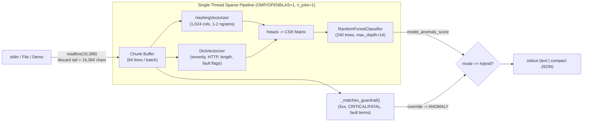

# Log Anomaly Detector

A streaming log anomaly classifier engineered to run inside a hard **240 MiB** memory and swap ceiling (`--memory=240m --memory-swap=240m`) on a read-only container filesystem (`read_only: true`, `cap_drop: ALL`).

Standard `scikit-learn` services blow past small container limits for predictable reasons: unbounded token vocabularies, OpenMP/BLAS thread arenas multiplying across CPU cores, `n_jobs=-1` worker forks, and full-line buffering on malformed input. This project closes each of those allocation paths so a `240`-tree Random Forest plus deterministic operational guardrails runs cleanly under a fixed memory budget.

---

## Memory-Bounded Execution Path



Four mechanisms keep resident memory predictable under load:

`_iter_bounded_lines()` reads at most `16,384` characters (`MAX_LINE_CHARS`) per record via `readline(MAX_LINE_CHARS + 2)`. When an oversized line arrives without a newline, the remainder is drained and discarded in bounded chunks rather than buffered in RAM—so a single multi-megabyte log dump cannot trigger an OOM kill. Custom training corpora are capped similarly (`--max-train-records`, default `50,000`).

Feature extraction pairs a stateless `HashingVectorizer(n_features=1024, ngram_range=(1, 2), norm="l2", alternate_sign=False)` with a sparse `DictVectorizer` encoding structural cues from `metadata_features()` (line-length bucket, parsed severity, HTTP `>= 400`, and keyword indicators for timeouts, OOM, disk exhaustion, auth failures, restarts, and network faults). Joining them into a single CSR matrix eliminates any growing vocabulary table:

```text
[  1,024 hashed unigram/bigram L2 weights  |  sparse structural metadata flags  ]
|<-------------- fixed width ------------->|<-------- bounded feature set ------->|
```

In both `Dockerfile` and `benchmarks/benchmark.py`, `OMP_NUM_THREADS`, `OPENBLAS_NUM_THREADS`, `MKL_NUM_THREADS`, and `NUMEXPR_NUM_THREADS` are pinned to `1`, and the forest runs with `n_jobs=1`. Without those guards, worker forks and BLAS thread pools silently allocate tens of megabytes per core before a single log line is scored.

At startup, `LogAnomalyDetector.fit()` trains in memory on the bundled baseline corpus (or `--normal-training` / `--anomaly-training` when supplied) instead of deserializing `pickle`/`joblib` binaries from disk. That avoids `scikit-learn` artifact incompatibility across versions and allows the container to run with a completely read-only root filesystem.

---

## Hybrid Decision Logic & Evaluation

During `detect_batch()`, `RandomForestClassifier.predict_proba()` always evaluates every non-empty line in the `64`-record batch first. In default `hybrid` mode, `_matches_guardrail()` then overrides known operational signatures: HTTP `5xx` statuses, `CRITICAL` or `FATAL` severities, `ERROR` lines containing explicit failure terms (`exception`, `traceback`, `oom`, `disk full`, `connection refused`, `authentication failed`), `WARN` lines indicating resource pressure (`high cpu`, `high memory`, `memory exhausted`, `disk full`), and high-confidence strings like `kernel panic`.

Scoring with the forest before checking guardrails costs a tiny slice of CPU per batch, in exchange for keeping `model_anomaly_score` populated on every emitted `Detection` record—allowing operators to observe classifier drift even on rule-caught incidents. Passing `--mode ml-only` disables guardrails completely so decisions rely solely on `anomaly_prob >= 0.5`.

Evaluation (`evaluation/evaluate_model.py`, persisted in `evaluation/results.json`, `seed=20261103`) enforces a **template-disjoint holdout** so exact phrasing from training never leaks into test scores. Training uses `320` normal and `320` anomaly records across `12 + 13` templates; validation uses `120` normal-only records; and testing spans `340` records across `4` unseen normal templates, `5` unseen anomaly templates, and `20` prefix-free challenge cases:

| Configuration | Precision | Recall | F1 | FPR | Accuracy |
|---|---|---|---|---|---|
| Random Forest (`ml-only`) | `0.9843` | `0.7353` | `0.8418` | `0.0118` | `0.8618` |
| Hybrid (`RF + guardrails`) | `0.9877` | `0.9471` | `0.9670` | `0.0118` | `0.9676` |

Of the `340` held-out decisions in hybrid mode, `124` came from `operational_guardrail` and `216` from `random_forest_classifier`.

---

## Running Locally & CLI Reference

Install the pinned runtime dependencies (`numpy==2.3.5`, `scipy==1.17.0`, `scikit-learn==1.8.0`):

```bash
pip install -r requirements.txt
```

Run the demo fixture, stream from a file or `stdin`, or train on labelled logs:

```bash
python app.py --demo
python app.py --demo --mode ml-only --format json
python app.py --input samples/sample.log --format json
cat samples/sample.log | python app.py --batch-size 64
python app.py --normal-training normal.log --anomaly-training anomaly.log --input app.log
```

Sample output under `--format json`:

```json
{"label":"ANOMALY","decision_value":-0.4875,"model_anomaly_score":0.9875,"message":"ERROR: HTTP 500 Internal Server Error","source":"operational_guardrail"}
```

| Flag | Default | Notes |
|---|---|---|
| `--demo` | off | Stream the 6-line built-in fixture (mutually exclusive with `--input`) |
| `--input PATH` | `stdin` | Stream bounded lines from `PATH` |
| `--normal-training PATH` | bundled | Custom normal corpus (must be paired with `--anomaly-training`) |
| `--anomaly-training PATH` | bundled | Custom anomaly corpus (requires at least `8` normal and `8` anomaly records) |
| `--mode` | `hybrid` | `hybrid` (RF + guardrails) or `ml-only` |
| `--format` | `text` | Human-readable lines or compact single-line `json` |
| `--batch-size` | `64` | Records vectorized per `predict_proba` call (`>= 1`) |
| `--max-train-records` | `50000` | Line cap per custom training file (`>= 8`) |

---

## Container Verification & Benchmarks

The Compose service (`docker-compose.yml`) drops all Linux capabilities (`cap_drop: ALL`), blocks privilege escalation (`no-new-privileges: true`), mounts `/` read-only with a `16 MiB` `/tmp` `tmpfs`, runs as UID/GID `10001`, and caps memory and swap identically at `240 MiB`:

```bash
docker compose up --build
```

`scripts/validate_docker.py` automates a 4-step empirical memory check: it builds the image, runs `--demo` under `--memory=240m --memory-swap=240m`, samples `docker stats` alongside the container's `cgroup` peak (`scripts/container_memory_probe.py`), confirms `oom_killed == false`, and writes `docker-validation-results.json`:

```bash
python scripts/validate_docker.py
```

To compare single-record vs. `64`-record batch throughput and process peak RSS (`resource.getrusage`):

```bash
python benchmarks/benchmark.py --records 5000 --batch-size 64
```

---

## Layout & Tests

```text
app.py                          # Bounded ingestion, feature fusion, RF + guardrails, CLI
training_data.py                # Baseline training corpus and template generator
evaluation/                     # Template-disjoint evaluation runner and results.json
benchmarks/benchmark.py         # Single vs. batch throughput and peak RSS probe
scripts/                        # 240 MiB Docker + cgroup memory validation suite
samples/sample.log              # Sample input fixture for local CLI tests
tests/                          # test_app.py, test_evaluation.py, test_docker_validation.py
```

```bash
python -m unittest -v
python -m evaluation.evaluate_model --output evaluation/results.json
```

`.github/workflows/ci.yml` executes `unittest` with `coverage`, runs `--demo` in both modes, regenerates `evaluation/results.json`, and compiles all modules across Python `3.11` and `3.13`.

---

## Limitations

- **Synthetic template corpus.** Bundled training and held-out logs are template-generated rather than production telemetry. Supply `--normal-training` and `--anomaly-training` to calibrate on real service logs.
- **Uncalibrated `0.5` decision threshold.** Classifier probabilities are thresholded directly at `0.5` without calibration against production base rates; the validation split is normal-only and not used for threshold tuning.
- **Stateless line-by-line scoring.** Multi-line stack traces and cross-request error bursts across time windows are outside the detector's scope; each log line is classified independently.
- **Cold-start fit on startup.** Training in memory avoids disk state and `read_only` volume mounts, at the cost of fitting the `240`-tree forest each time the process boots.
